# 研发效能智能体平台 · 技术方案（DevMind）

> 工作名：**DevMind** —— 一个 AI 原生的内部研发效能智能体平台。
> 5 个垂直 Agent 共享同一套「Agent 内核」（编排 / 记忆 / 工具 / LLM 网关 / 可观测）。
>
> **已确认选型**
> - 主力 LLM：**国内模型**（DeepSeek / 通义千问 / 智谱 GLM），统一通过 **LiteLLM** 网关接入并按场景路由
> - 对接平台：**GitHub + Jira + Confluence**
> - 前端：**React 18 + TypeScript**
> - 后端：**Python + FastAPI**（模块化单体起步，微服务就绪）

---

## 一、产品定位

把团队研发全链路中**重复、跨系统、需要上下文**的工作交给自主 Agent：

| # | Agent | 触发方式 | 解决的痛点 |
|---|---|---|---|
| 1 | **代码审查 Agent** | GitHub PR Webhook | 评审耗时、标准不统一、低级问题反复 |
| 2 | **告警根因 Agent** | 监控告警 Webhook | On-call 手动翻日志/监控/发布记录 |
| 3 | **需求拆解 Agent** | 手动 / Confluence 事件 | PRD→任务→排期 的人工搬运 |
| 4 | **知识答疑 Agent** | IM 机器人 / Web 提问 | tribal knowledge 散落、新人反复问 |
| 5 | **代码理解 Agent** | 手动 / 定时索引 | 遗留系统无文档、上手慢 |

**核心洞察**：这 5 个 Agent 不是 5 个独立项目，而是同一个「Agent 内核」上跑的 5 套工作流。做完内核，新增 Agent 只是配置 + 编排。这是学习「平台级 Agent 工程」的关键。

---

## 二、整体架构

```mermaid
graph TB
    subgraph Ingress["接入层"]
        WEB["React 控制台"]
        WH["Webhook 接收器<br/>(GitHub/监控)"]
        BOT["IM 机器人<br/>(飞书/Slack)"]
        CRON["定时触发器"]
    end

    subgraph Gateway["API 网关层"]
        GW["FastAPI Gateway<br/>(Auth / RBAC / 限流)"]
    end

    subgraph Core["Agent 内核 (共享)"]
        ORCH["编排引擎<br/>LangGraph"]
        TOOLS["工具注册中心<br/>(MCP)"]
        MEM["记忆服务<br/>短期+长期+情景"]
        LLMGW["LLM 网关<br/>LiteLLM → 国内模型"]
        CTX["上下文构建器<br/>RAG"]
        HITL["人工介入闸门"]
    end

    subgraph Agents["5 个垂直 Agent (工作流)"]
        A1["代码审查"]
        A2["告警根因"]
        A3["需求拆解"]
        A4["知识答疑"]
        A5["代码理解"]
    end

    subgraph Integrations["能力/集成层 (Tools)"]
        GIT["GitHub API"]
        JIRA["Jira / Confluence API"]
        MON["Prometheus / 日志"]
        CODE["AST / 代码图谱"]
    end

    subgraph Data["数据与基础设施"]
        PG[("PostgreSQL<br/>+ pgvector")]
        REDIS[("Redis<br/>缓存/队列")]
        MQ[["RabbitMQ<br/>事件总线"]]
        MINIO[("MinIO<br/>对象存储")]
        NEO[("Neo4j<br/>代码图谱")]
    end

    subgraph Obs["可观测/治理"]
        LF["Langfuse<br/>Trace/Eval"]
        PROM["Prometheus<br/>+ Grafana"]
    end

    WEB & WH & BOT & CRON --> GW
    GW --> ORCH
    ORCH --> Agents
    Agents --> TOOLS & MEM & CTX & HITL
    TOOLS --> Integrations
    CTX --> LLMGW
    ORCH --> LLMGW
    Integrations --> Data
    MEM --> PG & REDIS
    Core -.trace.-> LF
    Core -.metrics.-> PROM
    WH --> MQ --> ORCH
```



---

## 三、分层架构详解

| 层 | 职责 | 关键设计 |
|---|---|---|
| **接入层** | 统一所有触发入口 | Webhook 异步入队（不阻塞），SSE 流式返回 Agent 输出 |
| **网关层** | 鉴权、限流、路由、审计 | OAuth2/OIDC + JWT + RBAC；每次 Agent 调用全量审计 |
| **Agent 内核** | 5 个 Agent 共享的运行时 | 编排/工具/记忆/LLM/上下文 全部抽象成可复用服务 |
| **垂直 Agent** | 各自的 LangGraph 工作流 | 只定义「节点 + 用哪些工具」，复用内核 |
| **能力层** | 对接外部系统的工具 | 全部封装成 **MCP Server**，工具可插拔、可被任意 Agent 复用 |
| **数据层** | 持久化与缓存 | 关系库 + 向量库 + 图库 + 对象存储 各司其职 |
| **可观测层** | LLM 追踪 + 系统指标 + 评估 | 每一步 prompt/token/耗时/成本可回溯 |

---

## 四、完整技术栈清单

### 前端
| 技术 | 选型 | 说明 |
|---|---|---|
| 框架 | **React 18 + TypeScript** | 已确定 |
| 构建 | **Vite** | 业界主流，快 |
| UI 库 | **Ant Design 5** | 企业内部平台标配（备选 shadcn/ui + Tailwind 走现代风） |
| 服务端状态 | **TanStack Query (React Query)** | 缓存/重试/失效，处理 API 数据 |
| 客户端状态 | **Zustand** | 轻量，避免 Redux 样板 |
| 路由 | **React Router v6** | |
| 流式输出 | **SSE (EventSource)** | 实时展示 Agent 思考/输出 |
| 图表 | **ECharts / Recharts** | 告警趋势、代码图谱可视化 |
| 实时通知 | **WebSocket** | Agent 任务状态推送 |

### 后端（核心）
| 技术 | 选型 | 理由 |
|---|---|---|
| 语言 | **Python 3.11+** | Agent 生态（LangGraph/LangChain）全在 Python，第一公民 |
| Web 框架 | **FastAPI** | 异步、原生 SSE/WebSocket、Pydantic 校验、业界 AI 服务标准 |
| 数据校验 | **Pydantic v2** | |
| **Agent 编排** | **LangGraph** | 状态机式编排，可控、可中断、支持 HITL、状态持久化（生产首选） |
| 集成/工具 | **LangChain + MCP** | LangChain 提供工具生态，自研工具封装成 MCP Server |
| 异步任务 | **Celery + Redis** | 长耗时 Agent 任务跑后台 worker（备选 ARQ 异步原生） |
| ORM | **SQLAlchemy 2.0 + Alembic** | ORM + 数据库迁移 |
| 鉴权 | **OAuth2/OIDC + JWT** | SSO 对接公司账号 |

> **架构形态**：**模块化单体（Modular Monolith）起步，微服务就绪**。先用清晰的模块边界（gateway / agent-runtime / integrations / knowledge）跑一个 FastAPI 服务，需要扩展时按边界拆分。这是中小团队的业界最佳实践——不要一上来就微服务。
>
> **可选 polyglot**：若想体验多语言协作，可把「高并发 Webhook 接收 + 事件分发」单独用 **Go** 写成轻量 ingestion 服务，Agent 核心仍是 Python。初期不建议拆。

### LLM 层（国内模型方案）
| 技术 | 选型 | 说明 |
|---|---|---|
| LLM 网关 | **LiteLLM** | 一套 OpenAI 兼容接口统一接入国内模型，可切换/降级/统计成本 |
| 主力模型 | **DeepSeek-V 系列**（推理/编码强、性价比高） | 代码审查、代码理解、根因分析主力 |
| 备选模型 | **通义千问 Qwen-Max / 智谱 GLM-4** | 通过 LiteLLM 路由，按场景或降级切换 |
| Embedding | **bge-m3**（开源，可本地部署）或 **通义/智谱 Embedding API** | RAG 向量化 |
| Rerank | **bge-reranker-v2** | RAG 召回后精排，显著提升答疑质量 |
| Prompt 管理 | **Langfuse Prompt** | 版本化管理，避免 prompt 散落代码 |

> **LiteLLM 路由策略示例**：编码/审查类 → DeepSeek；长文档理解 → Qwen-Max；高并发轻量问答 → GLM-4-Flash；某模型超时/限流时自动降级到备选。

### 数据与存储
| 用途 | 选型 | 说明 |
|---|---|---|
| 关系库 | **PostgreSQL 16** | 主数据库 |
| 向量检索 | **pgvector** | 起步用 PG 插件，少一套系统（规模大再上 **Qdrant/Milvus**） |
| 缓存/队列 | **Redis** | 缓存、Celery broker、限流、会话 |
| 事件总线 | **RabbitMQ** | Webhook 异步解耦（轻量可用 Redis Streams） |
| 对象存储 | **MinIO** | S3 兼容，存日志快照、diff、报告产物 |
| 图数据库 | **Neo4j** | 专给「代码理解 Agent」存调用图/依赖图 |

### 可观测 / LLMOps
| 用途 | 选型 |
|---|---|
| LLM 追踪 + 评估 | **Langfuse**（自托管，开源，看每一步 prompt/token/成本/耗时） |
| 系统指标 | **Prometheus + Grafana** |
| 分布式追踪 | **OpenTelemetry** |
| 结构化日志 | **structlog** |
| 质量评估 | **RAGAS**（RAG 质量）+ **promptfoo**（prompt 回归测试） |

### DevOps / 基础设施
| 用途 | 选型 |
|---|---|
| 本地编排 | **Docker + Docker Compose** |
| 生产编排 | **Kubernetes + Helm** |
| CI/CD | **GitHub Actions** |
| 包管理 | **uv / Poetry**（Python）、**pnpm**（前端） |

---

## 五、共享 Agent 内核设计（最核心的部分）

这是整个平台的灵魂，5 个 Agent 全部复用：

| 内核组件 | 职责 | 关键点 |
|---|---|---|
| **编排引擎** | 用 LangGraph 跑工作流（节点=步骤，边=条件转移） | 支持循环（自我修正）、中断（等人工审批）、状态持久化（断点续跑） |
| **工具注册中心** | 所有外部能力封装成 MCP 工具，统一注册 | Agent 按需声明可用工具，工具可被多 Agent 复用 |
| **记忆服务** | 短期（本次会话）+ 长期（向量库）+ 情景（历史运行） | 越用越聪明的关键——比如代码审查 Agent 记住团队偏好 |
| **上下文构建器** | RAG 检索 + Prompt 组装 | 召回 → Rerank → 去重 → 拼装，控制上下文窗口 |
| **LLM 网关** | LiteLLM 统一调用国内模型 + 降级 + 成本统计 | |
| **人工介入闸门** | 关键节点暂停等人确认（HITL） | 比如需求 Agent 建 Jira 前让人 review |
| **事件总线** | 接收 Webhook/定时/IM，路由到对应 Agent | 异步、可重试、幂等 |

---

## 六、5 个 Agent 的工作流设计

### 1. 代码审查 Agent
- **触发**：GitHub PR 创建/更新 Webhook → 入队
- **工作流**：拉 diff → 检索本仓库上下文 + 团队历史规范（向量库）→ 分块审查 → 汇总评论 → 回写 PR Review → （CI 失败可循环建议修复）
- **工具**：GitHub API、代码检索、规则库
- **学到**：事件驱动、diff 理解、规则沉淀

### 2. 告警根因 Agent
- **触发**：监控告警 Webhook
- **工作流**：并行拉取（日志 + 监控指标 + 最近发布 commit）→ 关联分析 → 生成假设 → 验证 → 输出「最可能根因 + 涉及 commit + 建议」→ 推送 IM
- **工具**：Prometheus API、日志检索、GitHub history
- **学到**：多系统并行编排、假设验证循环（AIOps 核心）

### 3. 需求拆解 Agent
- **触发**：手动提交 Confluence PRD 链接
- **工作流**：读 PRD（含图）→ 拆功能点 → 生成前后端任务 + 估点 → **HITL 人工确认** → 写入 Jira Epic/子任务 → 回写关联
- **工具**：Confluence / Jira API
- **学到**：文档理解、结构化输出、HITL、多系统写入

### 4. 知识答疑 Agent
- **触发**：IM @机器人 或 Web 提问
- **工作流**：多源召回（Confluence + 代码 + 历史问答）→ Rerank → 生成带引用答案 → 置信度低则说「不确定」→ 记录未答问题
- **工具**：多源 RAG
- **学到**：生产级 RAG、来源引用、知识缺口回填

### 5. 代码理解 Agent
- **触发**：手动 / 定时索引仓库
- **工作流**：AST 解析 → 构建调用图（存 Neo4j）→ 分层摘要 → 按需回答「这个模块干嘛 / 改动影响哪些地方」
- **工具**：tree-sitter、Neo4j、代码检索
- **学到**：代码图谱、分层摘要、影响分析

---

## 七、核心数据模型（简化）

```
User / Team / Role                              —— 鉴权与多租户
Integration                                     —— 外部系统连接配置（GitHub/Jira/监控）
Project / Repository                            —— 被管理的项目
AgentDefinition                                 —— Agent 配置（用哪些工具、哪个工作流）
AgentRun                                        —— 一次执行（状态、输入、输出、trace_id、成本）
ToolCall                                        —— 运行中的每次工具调用（审计）
KnowledgeDoc / Chunk / Embedding                —— 知识库与向量
ReviewComment / Incident / Requirement / CodeGraphNode  —— 各 Agent 业务实体
```

---

## 八、建议目录结构（待落地）

```
ai-knowledge-agent/
├── backend/                      # Python + FastAPI
│   ├── app/
│   │   ├── main.py               # FastAPI 入口
│   │   ├── core/                 # 配置、鉴权、日志、可观测
│   │   ├── gateway/              # API 路由、SSE、WebSocket
│   │   ├── kernel/               # ★ Agent 内核（编排/记忆/上下文/LLM 网关/HITL）
│   │   │   ├── orchestrator/     # LangGraph 工作流引擎
│   │   │   ├── memory/           # 短期/长期/情景记忆
│   │   │   ├── llm/              # LiteLLM 网关 + 路由策略
│   │   │   ├── rag/              # 检索 + Rerank + 上下文构建
│   │   │   └── tools/            # 工具注册中心（MCP）
│   │   ├── agents/               # ★ 5 个垂直 Agent 工作流
│   │   │   ├── code_review/
│   │   │   ├── incident_rca/
│   │   │   ├── requirement/
│   │   │   ├── knowledge_qa/
│   │   │   └── code_understanding/
│   │   ├── integrations/         # GitHub / Jira / Confluence / 监控 客户端
│   │   ├── models/               # SQLAlchemy 模型
│   │   ├── schemas/              # Pydantic 模型
│   │   └── workers/              # Celery 任务
│   ├── alembic/                  # 数据库迁移
│   ├── tests/
│   └── pyproject.toml
├── frontend/                     # React 18 + TS + Vite
│   ├── src/
│   │   ├── pages/                # 控制台页面（各 Agent / 运行记录 / 知识库）
│   │   ├── components/
│   │   ├── api/                  # TanStack Query 封装
│   │   ├── store/                # Zustand
│   │   └── hooks/
│   └── package.json
├── deploy/
│   ├── docker-compose.yml        # 本地一键起（PG/Redis/RabbitMQ/MinIO/Neo4j/Langfuse）
│   └── helm/                     # K8s 部署
└── docs/
    └── 研发效能智能体平台-技术方案.md
```

---

## 九、分阶段路线图

| 阶段 | 目标 | 包含内容 | 你会学到 |
|---|---|---|---|
| **P0 地基** | 跑通内核 | FastAPI 骨架 + LiteLLM(国内模型) + LangGraph 最小循环 + PG/Redis + Langfuse + React 壳子 | Agent 基本循环、可观测 |
| **P1 第一个 Agent** | 知识答疑 Agent | RAG 全链路 + IM/Web 接入 | 生产级 RAG、记忆 |
| **P2 事件驱动** | 代码审查 Agent | GitHub Webhook + 异步队列 + 工具注册 | 事件驱动、MCP 工具 |
| **P3 多步推理** | 告警根因 Agent | 多系统编排 + 假设验证 | 复杂编排、AIOps |
| **P4 写操作 + HITL** | 需求拆解 Agent | Jira/Confluence 写入 + 人工闸门 | HITL、安全写操作 |
| **P5 图谱** | 代码理解 Agent | AST + Neo4j 代码图谱 | 代码图谱、影响分析 |
| **P6 工程化** | 生产就绪 | K8s 部署 + Eval 评估 + 成本治理 + RBAC | 平台化、LLMOps |

> **建议顺序**：P0 → P1（知识答疑，最容易出成果、立刻能用）→ P2（代码审查，最有「Agent」感）→ 其余按兴趣。每个阶段都是独立可用的成果。

---

## 十、学习价值地图

做完这一个平台，你会完整掌握业界做 AI Agent 的全套能力：

- **Agent 工程**：LangGraph 编排、ReAct、HITL、自我修正、状态持久化
- **检索**：RAG、向量库、Rerank、多源融合
- **集成**：MCP 工具体系、Webhook 事件驱动、多系统编排
- **LLMOps**：可观测（Langfuse）、评估（RAGAS/promptfoo）、成本治理、模型路由（LiteLLM）
- **全栈工程**：React + FastAPI + PG/Redis/RabbitMQ/MinIO/Neo4j + K8s 部署
- **架构能力**：模块化单体 → 微服务演进、平台化抽象

---

## 附录：关键技术决策记录（ADR 摘要）

| 决策 | 选择 | 理由 |
|---|---|---|
| 后端语言 | Python | Agent 生态第一公民，LangGraph/LangChain 原生 |
| 编排框架 | LangGraph（非裸 LangChain Agent） | 可控状态机、支持中断与 HITL、可持久化 |
| LLM 接入 | LiteLLM 网关 | 统一国内多模型接口，按场景路由 + 降级 |
| 向量库 | pgvector 起步 | 减少初期基础设施，复用 PG |
| 架构形态 | 模块化单体 | 中小团队最佳实践，避免过早微服务化 |
| 可观测 | Langfuse 自托管 | 开源、可私有部署，符合内网要求 |
